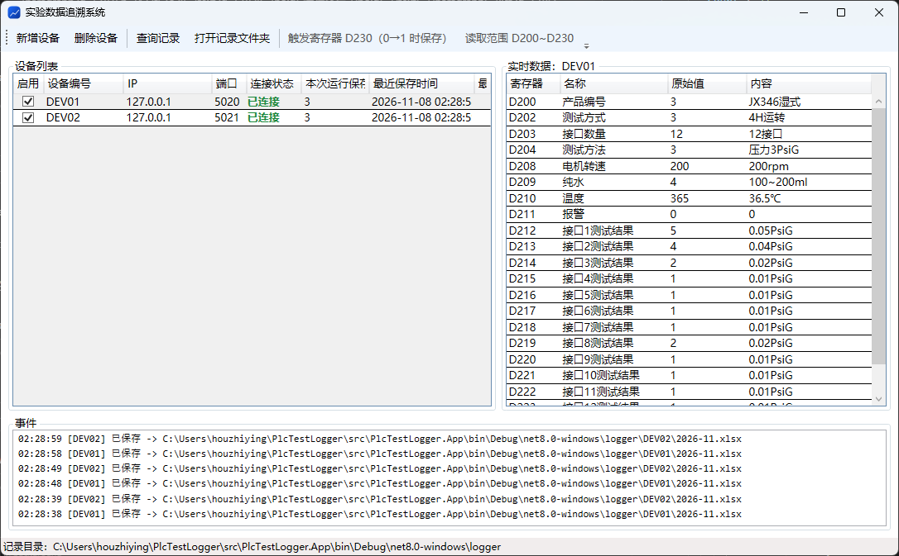
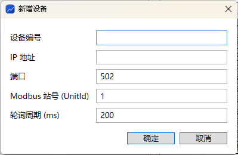
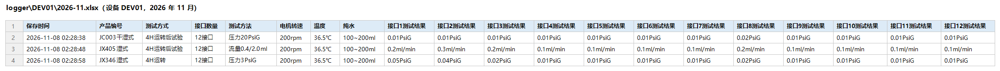
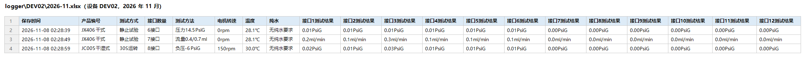
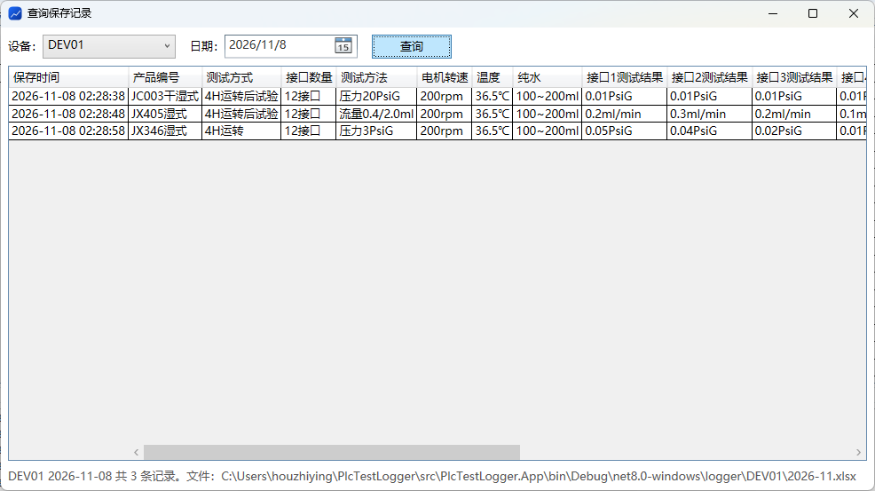

# 实验数据追溯系统 用户操作说明


版本：2026-11-08

## 1. 系统简介

实验数据追溯系统（PlcLogger.exe）实时读取汇川 Easy521 PLC 的 D200–D230 寄存器，在 PLC 发出“测试完成”信号（D230 由 0 变 1）时，自动把这一次测试的结果记入 Excel。每台设备、每个月一个 Excel 文件，可随时按设备、按日期查询。

**运行环境**

- Windows 10 / 11，无需安装 .NET 运行时（发布包自带）。
- PLC 开启 Modbus TCP（默认端口 502），电脑与 PLC 在同一网络。

**目录结构**（全部位于 PlcLogger.exe 所在文件夹）

| 路径 | 作用 |
| --- | --- |
| PlcLogger.exe | 主程序 |
| config\registers.json | 寄存器含义、常量选项、Excel 列顺序、触发寄存器 |
| config\devices.json | 设备列表（界面新增/删除/启停设备时自动写回） |
| logger\<设备编号>\2026-11.xlsx | 记录文件，一台设备一个文件夹，一个月一个文件 |
| logger\<设备编号>\2026-11.pending.tsv | Excel 被占用时的暂存记录，关闭 Excel 后自动合并 |
| logs\app-20261108.log | 程序运行日志，排查问题时查看 |

## 2. 启动与主界面

双击 PlcLogger.exe 启动，程序会立即连接设备列表中所有已启用的设备并开始轮询，不需要额外点“开始”。程序运行期间请保持窗口打开（可最小化），关闭窗口即停止记录。



主界面分为四个区域：

| 区域 | 内容 |
| --- | --- |
| 工具栏 | 新增设备、删除设备、查询记录、打开记录文件夹；右侧显示当前配置的触发寄存器和读取范围 |
| 设备列表（左） | 每台设备一行：启用开关、设备编号、IP、端口、连接状态、本次运行保存条数、最近保存时间、最近错误 |
| 实时数据（右） | 左侧选中哪台设备，就显示哪台设备 D200–D230 的当前值：原始值为 PLC 里的数字，内容为换算后的语义（与写入 Excel 的完全一致）；备用寄存器不显示 |
| 事件（下） | 每次保存、连接错误、设备增删启停的提示，最新的在最上面 |

**连接状态的含义**

| 状态 | 含义 | 处理 |
| --- | --- | --- |
| 已连接（绿） | 正常读取中 | 无需处理 |
| 重连中（橙） | 连不上 PLC，程序每 1–5 秒自动重试 | 检查网线、PLC 电源、IP 是否正确；最近错误列有具体原因 |
| 未连接（红） | 还没开始连接 | 刚启动时短暂出现，属正常 |
| 已停用 | 启用开关被关闭 | 需要记录时勾选启用 |

## 3. 设备管理

设备的增删和启停都在界面上完成，立即生效，并自动写回 config\devices.json，不需要重启程序。

**新增设备**



1. 点工具栏“新增设备”。
2. 填写设备编号（也是记录文件夹名，不能含 \ / : * ? " < > |）、PLC 的 IP 地址。
3. 端口、Modbus 站号、轮询周期一般保持默认（502 / 1 / 200 毫秒）。
4. 点“确定”，设备出现在列表中并开始连接。

**停用 / 启用**：取消设备行最前面的“启用”勾选，该设备停止轮询和保存，状态显示“已停用”；重新勾选即恢复。设备停机、检修或暂时不需要记录时使用，可以避免事件区不断提示连接失败。

**删除设备**：在列表中选中设备，点“删除设备”并确认。删除只移除设备配置，已保存的 Excel 文件不会删除。

## 4. 自动记录

记录完全自动：当 PLC 把触发寄存器（默认 D230）由 0 置为 1 的那一刻，程序把当时 D200–D230 的内容转换成一行记录，追加到该设备当月的 Excel 文件末尾。每次保存后设备列表的“本次运行保存”加 1，事件区显示文件路径。

**触发规则**

- 只在 0→1 的跳变时记录一次；D230 保持为 1 期间（例如 30 秒）不会重复记录。
- D230 必须先回到 0，再变为 1，才会记录下一条。
- 程序启动或断线重连时如果 D230 已经是 1，不会补记；断线期间完成的测试不会被记录。

**Excel 文件**

- 位置：PlcLogger.exe 旁边的 logger\<设备编号>\<年-月>.xlsx，例如 logger\DEV01\2026-11.xlsx。点工具栏“打开记录文件夹”可直接打开。
- 格式：第一列为保存时间，之后依次是产品编号、测试方式、接口数量、测试方法、电机转速、温度、纯水、接口 1–12 测试结果。常量型寄存器已转成文字（如 1 → JX321干式），数值型已带单位（如 365 → 36.5℃）。
- 每月 1 日的第一条记录自动开新文件。

两台设备各记录 3 次后的 Excel 内容如下（样例文件见 samples\logger）：





**文件被打开时**：如果当月文件正在 Excel / WPS 中打开，程序写不进去，会把记录暂存到同目录的 <年-月>.pending.tsv，事件区提示“Excel 被占用”。关闭 Excel 后，下一条记录写入时会自动把暂存的记录合并进去，不会丢失。建议查看记录时复制一份再打开，或使用程序的查询窗口。

## 5. 查询历史记录

查询窗口按“设备 + 日期”列出当天的全部记录，不必打开 Excel，也不会影响正在进行的记录。



1. 点工具栏“查询记录”。
2. 在“设备”下拉框选设备编号（默认是主界面当前选中的设备）。
3. 在“日期”选要查的那一天（默认今天）。
4. 点“查询”或按回车，表格显示当天记录，底部状态栏显示条数和所在文件。

表格中的内容和 Excel 里完全一致，可以拖选后 Ctrl+C 复制到 Excel 或邮件中。当天没有记录时状态栏会提示“没有记录”。被 Excel 占用期间暂存的记录在这里同样能查到。

## 6. 配置文件

两个配置文件都在 config 文件夹，用记事本或 VS Code 编辑，保存后重启程序生效（devices.json 也可在界面上改）。改完请确认 JSON 格式正确，否则程序启动时会提示错误并退出。

**devices.json — 设备列表**

```json
{
  "devices": [
    { "id": "DEV01", "ip": "192.168.1.10", "port": 502, "unitId": 1, "pollIntervalMs": 200, "enabled": true }
  ]
}
```

**registers.json — 寄存器含义**，常见修改：

| 要改什么 | 改哪里 |
| --- | --- |
| 触发保存的寄存器 | 顶层 triggerRegister（默认 230） |
| 某个选项的文字（如产品编号 1 对应的名称） | 该寄存器的 options，键是 PLC 里的数值，值是显示文字 |
| 新增一个选项 | 在 options 里加一行，例如 "26": "JX410干式" |
| 数值的倍率 / 小数位 / 单位 | 该寄存器的 scale / decimals / unit（如温度 365 → 36.5℃ 是 scale 0.1、decimals 1） |
| 接口结果的单位随测试方法变化 | D204 的 resultUnits / resultScales / resultDecimals |
| 某寄存器是 32 位整数或浮点数 | 该寄存器加 "dataType": "int32" / "uint32" / "float32"，它会占用下一个地址；字序不对时改顶层 wordOrder 为 highLow |
| 寄存器是备用、不想显示 | 该寄存器加 "enabled": false |
| Excel 列顺序 / 要不要某列 | 顶层 excelColumns，按顺序列出寄存器编号 |
| PLC 地址映射不是 D0 对应 0 | 顶层 dRegisterBase |

当月中途改了 Excel 列（excelColumns 或列名），程序会自动另起一个 <年-月>_v2.xlsx，避免新旧列错位；查询窗口会合并显示。

## 7. 常见问题与处理

| 现象 | 原因 | 处理 |
| --- | --- | --- |
| 设备一直“重连中”，最近错误为“由于目标计算机积极拒绝” | PLC 未开启 Modbus TCP，或端口不对 | 在 PLC 中启用 Modbus TCP 服务，确认端口 502 |
| 最近错误为“连接超时” | IP 不对、网线未接、不在同一网段 | 在电脑上 ping PLC 的 IP；核对设备 IP |
| 已连接，但测试完成后没有记录 | D230 没有从 0 变 1（一直是 1，或触发寄存器配置错了） | 看实时数据里 D230 的值；核对 registers.json 的 triggerRegister |
| 实时数据的数字对，但“内容”显示 K37 之类 | PLC 的值不在选项表里 | 在 registers.json 的 options 中补上该值 |
| 温度 / 压力数值差 10 倍或 100 倍 | 倍率设置与 PLC 存法不一致 | 调整该寄存器的 scale 和 decimals |
| 事件区提示“Excel 被占用，记录已暂存” | 当月 xlsx 正在 Excel/WPS 中打开 | 关闭 Excel，下一条记录会自动合并暂存记录 |
| 启动时提示“配置文件加载失败” | JSON 格式错误（少逗号、引号不配对） | 按提示的文件和原因修改；用 VS Code 打开会标红错误位置 |
| 想查看更早的记录 | — | 查询窗口选对应日期；或直接打开 logger\<设备>\<年-月>.xlsx |
| 换电脑 / 升级程序 | — | 整个文件夹拷贝即可；升级时保留 config 和 logger 文件夹 |

遇到无法判断的问题，把 logs\app-日期.log 文件发给维护人员。
